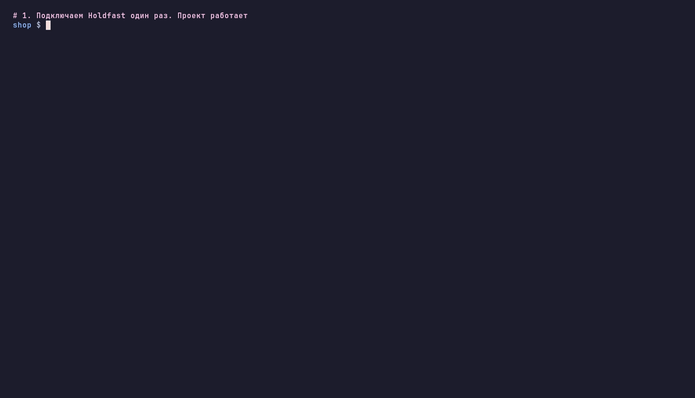

# Holdfast

**Линтер инструкций и предохранитель для ИИ-агентов** (Claude Code, Cursor, Codex и др.).

- `holdfast lint` находит в `CLAUDE.md` / `AGENTS.md` / `.cursorrules` битые пути,
  несуществующие команды, противоречия, дубли, секреты и лишний текст.
- `holdfast guard` встраивается в Claude Code как PreToolUse-хук. Он не тормозит агента
  вопросами, а направляет: необратимое (`rm -rf ~`, `git push --force`, `curl | sh`, `.env`)
  запрещает с подсказкой, как сделать правильно, обратимое разрешает под защитой снапшота,
  а нужные правила проекта показывает агенту в момент, когда он трогает файл.
- `holdfast sync` превращает запреты из `CLAUDE.md` в проверяемые правила guard:
  инструкция перестаёт быть просьбой.

Один статический бинарник без зависимостей, хук отвечает за ~50 мкс (≈3 мс вместе со стартом процесса).



> Гифка записывается командой `vhs docs/demo.tape` (нужен [VHS](https://github.com/charmbracelet/vhs)).

## Установка

```bash
go install github.com/roma2246/holdfast/cmd/holdfast@latest
```

```bash
brew install --cask roma2246/tap/holdfast
```

Или скачайте архив под свою ОС со страницы [Releases](https://github.com/roma2246/holdfast/releases).

## Быстрый старт

```bash
cd my-project
holdfast init            # создаёт holdfast.toml
holdfast lint            # проверяет CLAUDE.md / AGENTS.md / .cursorrules
holdfast guard install   # подключает хук к Claude Code (.claude/settings.json)
holdfast guard start     # снапшот перед сессией агента
# ... работа агента ...
holdfast guard diff      # что изменилось с момента снапшота
holdfast guard rollback  # откатить всё (с подтверждением)
holdfast guard log       # что агенту разрешили и что заблокировали
```

## lint

```
$ holdfast lint
CLAUDE.md:3   HF001 error    путь «src/server/» не существует
CLAUDE.md:8   HF004 warning  противоречие: «use yarn» (строка 7) и «never use yarn»
CLAUDE.md:15  HF002 error    «npm run e2e» — скрипта e2e нет в package.json
    ↳ агент запустит несуществующую команду; обновите инструкцию
```

| ID    | Что проверяет                                                                 | Уровень |
|-------|-------------------------------------------------------------------------------|---------|
| HF001 | Путь из текста (`src/api/`, `docs/setup.md`) не существует                     | error   |
| HF002 | `npm run X` / `make X` / `just X` нет в package.json / Makefile / justfile     | error   |
| HF003 | Файл больше лимита (по умолчанию 2000 токенов ≈ символы / 4)                   | warning |
| HF004 | Противоречие: «use yarn» и «never use yarn»                                    | warning |
| HF005 | Дубли и почти одинаковые пункты (мера Жаккара по словам > 90%)                 | warning |
| HF006 | Похоже на секрет: API-ключ, токен, пароль                                      | error   |
| HF007 | Расплывчатые инструкции («write good code», «пиши чисто»)                      | info    |
| HF008 | Нет секции с командами сборки и тестов                                         | info    |
| HF009 | В инструкции есть запрет, которого нет в политике guard (запустите `sync`)     | warning |

Все проверки локальные, без вызовов LLM. Файлы проверяются параллельно.

- `--format json` — машиночитаемый отчёт для CI.
- `--strict` — warning тоже считается ошибкой.
- Коды выхода: `0` — нет ошибок, `1` — есть error, `2` — сбой самого инструмента.
- Выключить правило: `disable = ["HF007"]` в `holdfast.toml`,
  `<!-- holdfast-disable HF003 -->` на весь файл или
  `<!-- holdfast-disable-next-line HF001 -->` на следующую строку.

## guard

`holdfast guard install` добавляет в `.claude/settings.json` (не затирая остальное):

```json
{
  "hooks": {
    "PreToolUse": [{
      "matcher": "Bash|Edit|Write|MultiEdit|NotebookEdit|Read",
      "hooks": [{ "type": "command", "command": "holdfast guard check", "timeout": 10 }]
    }]
  }
}
```

Перед каждым вызовом инструмента Claude Code передаёт хуку JSON. Хук разбирает команду
настоящим парсером bash ([mvdan.cc/sh](https://github.com/mvdan/sh)), а не поиском подстроки:
проверяется каждая простая команда в цепочках `&&`, `;`, `|`, подстановках `$(...)`, `<(...)`,
`bash -c "..."`, `eval`, функциях и циклах, учитываются `sudo`/`env`/`timeout`/`xargs` и `cd`.
`echo "rm -rf /"` — безопасный echo, а `ls && rm -rf ~` — запрет.

### Не шлагбаум, а направляющие

Holdfast по умолчанию работает в режиме **`autonomous`**: агент не ждёт человека.

- **Необратимое — запрещено, но с подсказкой, как сделать правильно.** Агент получает причину
  и сам выбирает другой путь: `git push` в `main` → «создай ветку и предложи PR»,
  `rm -rf $DIR` → «подставь путь явно», чтение `.env` → «имена переменных смотри в `.env.example`».
- **Обратимое — разрешено.** Массовое удаление файлов проекта, `find -delete`, `git clean -f`
  проходят без вопросов, если есть снапшот (`holdfast guard start`): всё откатывается одной командой.
  Нет снапшота — агенту подсказывают его сделать.
- **Правило — в момент действия.** Когда агент читает или меняет файл, хук добавляет в его
  контекст правила именно для этого файла: строки `CLAUDE.md`/`AGENTS.md`, где упомянут путь,
  и заметки из `[[guard.context]]`. Каждая подсказка показывается один раз за сессию.
  Правила для отдельных папок можно вынести из CLAUDE.md в конфиг — он станет короче.
- **«Спросить» — только там, где вы сами попросили**: `ask_commands`, `protected_paths`, `ask-paths`.

| | autonomous (по умолчанию) | strict |
|---|---|---|
| `rm -r` на `/`, `~`, весь репозиторий, вне репозитория; `git push --force`; `git reset --hard`; `curl … \| sh`; `.env`, `*.pem`, `id_rsa` | запрет | запрет |
| `git push` в свою ветку | разрешено | спросить |
| `git push` в `main`/`master`, `--tags`, `--delete`, `--all` | запрет с подсказкой | спросить |
| удаление больше `max_deletes` файлов, `find -delete`, `git clean -f` | разрешено при снапшоте | спросить |
| `npm publish`, `rm -rf $VAR`, `xargs rm -r`, удаление вне репозитория | запрет с подсказкой | спросить |
| удаление во временных папках (`/tmp/...`) | разрешено | запрет / спросить |
| `ask_commands`, `protected_paths` из конфига | спросить | спросить |

Если хук не выносит решения, работает обычная проверка разрешений Claude Code — хук никогда
не одобряет действие молча. Хук никогда не падает: при внутренней ошибке он отвечает «спросить»
и пишет об этом в журнал. Журнал — `.holdfast/log.jsonl` (папка сама себя исключает из git).

**Снапшоты.** `guard start` сохраняет рабочее дерево — включая неотслеживаемые файлы —
в `refs/holdfast/<время>` через временный git-индекс. Ваши ветки, stash и индекс не меняются.
`guard rollback` перед откатом сохраняет текущее состояние в `refs/holdfast-backup/`,
так что и откат можно отменить. Файлы из `.gitignore` не трогаются.

## sync

```markdown
<!-- holdfast
deny-paths: migrations/**, .github/workflows/**
ask-commands: docker compose down
-->
```

`holdfast sync` переносит такие блоки в секцию `[guard.synced]` файла `holdfast.toml`
с указанием строки-источника. Ключи: `deny-paths`, `ask-paths`, `deny-commands`, `ask-commands`.

Фразы в тексте — «never edit `migrations/`», «don't touch generated/», «не трогай `vendor/`»,
«never run `make deploy`» — находятся эвристически: sync покажет их списком и добавит
только подтверждённые (`--yes` — принять все, `--no-heuristics` — только явные блоки,
`--dry-run` — ничего не записывать).

## Конфигурация

```toml
[lint]
files = ["CLAUDE.md", "AGENTS.md", ".cursorrules"]
max_tokens = 2000
disable = ["HF007"]

[guard]
mode = "autonomous"                    # или "strict" — подтверждение человека для рискованного
protected_branches = ["main", "master"]
protected_paths = ["migrations/**"]    # ** — любая глубина, * — в пределах папки
deny_commands = ["terraform destroy"]  # слова шаблона ищутся в команде по порядку
ask_commands = ["docker compose down"] # «спросить» — в любом режиме
max_deletes = 5

[[guard.context]]                      # подсказка агенту в момент работы с файлами
paths = ["migrations/**"]
note = "Существующие миграции не меняем: добавь новый файл 00N_описание.sql"
```

## Разработка

```bash
go build ./...
go test ./...
golangci-lint run ./...
go test -bench=BenchmarkHook -run='^$' ./internal/guard/
goreleaser build --snapshot --clean
```

Структура и соглашения — в [CLAUDE.md](CLAUDE.md).
