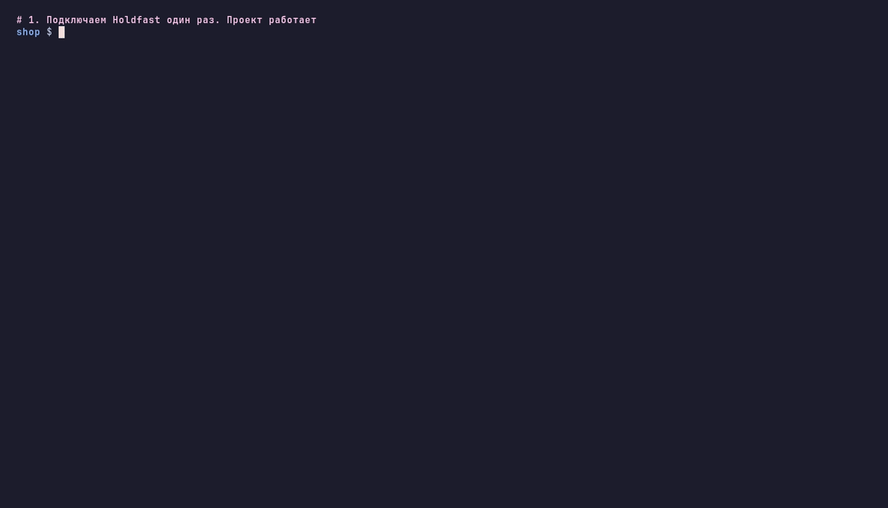

# Holdfast

[English](README.md) · **Русский**

**Точки восстановления и направляющие для ИИ-агентов.** `guard` работает с Claude Code,
`lint` — с файлами инструкций любых агентов (Claude Code, Cursor, Codex).

- **Точки восстановления.** Перед каждым вашим запросом к агенту Holdfast сам сохраняет
  состояние проекта. Если после задачи всё развалилось, откат возвращает файлы одной командой —
  включая то, что агент сделал командами терминала.
- **Направляющие.** Хук проверяет действия агента и не тормозит его вопросами: опасное
  (`rm -rf ~`, `git push --force`, `curl | sh`, чтение `.env`) запрещает с подсказкой, как
  сделать правильно, а правила проекта показывает агенту в момент, когда он трогает файл.
- **`holdfast lint`** находит в `CLAUDE.md` / `AGENTS.md` / `.cursorrules` битые пути,
  несуществующие команды, противоречия, дубли и секреты.
- **`holdfast sync`** переносит запреты из `CLAUDE.md` в правила хука.

Хук — это направляющие, а не песочница: он разбирает текст команд и не изолирует агента на
уровне файловой системы. Что он не ловит — в разделе [Ограничения](#ограничения).

Один статический бинарник; для точек восстановления нужен установленный git.
Хук отвечает за ~0,1 мс (≈3 мс вместе со стартом процесса).



> Перезаписать гифку: `./docs/demo/record.sh` — [VHS](https://github.com/charmbracelet/vhs) в Docker, нужны Docker и Go. Сценарий — [docs/demo.tape](docs/demo.tape).

## Установка

```bash
go install github.com/roma2246/holdfast/cmd/holdfast@latest
```

```bash
brew install --cask roma2246/tap/holdfast
```

Или скачайте архив под свою ОС со страницы [Releases](https://github.com/roma2246/holdfast/releases).

## Быстрый старт

```bash
cd my-project
holdfast guard install   # один раз: подключает Holdfast к Claude Code
holdfast doctor          # проверить, что всё подключено (✓/✗ с подсказками)
```

Дальше ничего делать не нужно: перед каждым вашим запросом агенту Holdfast сам сохраняет
точку восстановления. Если после очередной задачи всё развалилось:

```bash
holdfast guard list                     # точки: когда, перед каким запросом, что изменилось с тех пор
holdfast guard diff --to 2              # что именно поменялось после точки 2
holdfast guard rollback --to 2          # вернуть файлы к точке 2 (покажет список и спросит)
holdfast guard rollback --to 2 src/     # или выборочно откатить только отдельные файлы или папки
```

Встроенный `/rewind` Claude Code [не отслеживает](https://code.claude.com/docs/en/checkpointing#limitations)
файлы, которые менялись только командами терминала (`sed -i`, `rm`, генераторы кода), правки
субагентов в других файлах и ваши ручные изменения. Точка Holdfast — снимок всего рабочего
дерева, поэтому откат возвращает и это.

Остальное — по желанию:

```bash
holdfast init            # holdfast.toml: свои правила и подсказки агенту
holdfast lint            # проверяет CLAUDE.md / AGENTS.md / .cursorrules
holdfast guard log       # что агенту разрешили, что запретили и почему
```

## Проверка и удаление

`holdfast doctor` проверяет установку и для каждой проблемы печатает, как её исправить
(сообщения утилиты, справка и подсказки агенту — на английском):

```
✓ git is installed — git version 2.50.1
✓ Claude Code hooks — PreToolUse and UserPromptSubmit in .claude/settings.json
✓ binary for the hooks: holdfast — /usr/local/bin/holdfast
✓ holdfast.toml is readable
✓ no recent config-error entries in the log — entries in the last 24 h: 42
✓ restore points are created without errors — in the last 24 h: 12
✓ restore points in refs/holdfast/ — 12, the latest 3 min ago
```

Что проверяется: git установлен; оба хука прописаны в `.claude/settings.json` или
`settings.local.json`; программа из хуков находится в `PATH` или по указанному пути
(`guard install --bin`); `holdfast.toml` читается; в журнале нет ошибок `config-error` после
последней правки конфига и последняя точка не завершилась ошибкой; точки восстановления есть.
Код выхода — 0, если всё в порядке, и 2, если есть проблемы.

Удаление:

```bash
holdfast guard uninstall          # убрать хуки из .claude/settings.json (--local — из settings.local.json)
holdfast guard uninstall --purge  # и удалить журнал .holdfast/ и все точки восстановления (спросит)
```

`uninstall` убирает только хуки Holdfast: остальные настройки и чужие хуки остаются как были.
Без `--purge` точки восстановления сохраняются, и откатиться к ним можно и после удаления хуков.
`--purge` удаляет ссылки `refs/holdfast*/` во всех рабочих деревьях репозитория; сами объекты
git уберёт обычная сборка мусора (`git gc`). Затем удалите бинарник (`brew uninstall --cask holdfast`
или файл из `$(go env GOPATH)/bin`).

## lint

```
$ holdfast lint
CLAUDE.md:3   HF001 error    path "src/server/" does not exist
CLAUDE.md:8   HF004 warning  contradiction: "use yarn" (line 7) and "never use yarn"
CLAUDE.md:15  HF002 error    "npm run e2e": script e2e is not in package.json
    ↳ the agent will run a command that doesn't exist; update the instructions
```

| ID    | Что проверяет                                                                 | Уровень |
|-------|-------------------------------------------------------------------------------|---------|
| HF001 | Путь из текста (`src/api/`, `docs/setup.md`) не существует                     | error   |
| HF002 | `npm run X` / `make X` / `just X` нет в package.json / Makefile / justfile     | error   |
| HF003 | Файл больше лимита (по умолчанию 2000 токенов ≈ символы / 4)                   | warning |
| HF004 | Противоречие: «use yarn» и «never use yarn»                                    | warning |
| HF005 | Дубли и почти одинаковые пункты (мера Жаккара по словам > 90%)                 | warning |
| HF006 | Похоже на секрет: API-ключ, токен, пароль                                      | error   |
| HF007 | Расплывчатые инструкции («write good code», «пиши чисто»)                      | info    |
| HF008 | Нет секции с командами сборки и тестов                                         | info    |
| HF009 | В инструкции есть запрет, которого нет в политике guard (запустите `sync`)     | warning |

Все проверки локальные, без вызовов LLM. Файлы проверяются параллельно.

- `--format json` — машиночитаемый отчёт для CI.
- `--strict` — warning тоже считается ошибкой.
- Коды выхода: `0` — нет ошибок, `1` — есть error, `2` — сбой самого инструмента.
- Выключить правило: `disable = ["HF007"]` в `holdfast.toml`,
  `<!-- holdfast-disable HF003 -->` на весь файл или
  `<!-- holdfast-disable-next-line HF001 -->` на следующую строку.

## guard

`holdfast guard install` добавляет в `.claude/settings.json` (не затирая остальное;
с `--local` — в `.claude/settings.local.json`):

```json
{
  "hooks": {
    "PreToolUse": [{
      "matcher": "Bash|Edit|Write|MultiEdit|NotebookEdit|Read",
      "hooks": [{ "type": "command", "command": "holdfast guard check", "timeout": 10 }]
    }],
    "UserPromptSubmit": [{
      "hooks": [{ "type": "command", "command": "holdfast guard checkpoint", "timeout": 30 }]
    }]
  }
}
```

Первый хук проверяет каждое действие агента, второй сохраняет точку восстановления перед
каждым вашим запросом.

Перед каждым вызовом инструмента Claude Code передаёт хуку JSON. Хук разбирает команду
настоящим парсером bash ([mvdan.cc/sh](https://github.com/mvdan/sh)), а не поиском подстроки:
проверяется каждая простая команда в цепочках `&&`, `;`, `|`, подстановках `$(...)`, `<(...)`,
`bash -c "..."`, `eval`, функциях и циклах, учитываются `sudo`/`env`/`timeout`/`xargs` и `cd`.
`echo "rm -rf /"` — безопасный echo, а `ls && rm -rf ~` — запрет.

### Не шлагбаум, а направляющие

Holdfast по умолчанию работает в режиме **`autonomous`**: агент не ждёт человека.

- **Необратимое — запрещено, но с подсказкой, как сделать правильно.** Агент получает причину
  и сам выбирает другой путь: `git push` в `main` → «создай ветку и предложи PR»,
  `rm -rf $DIR` → «подставь путь явно», чтение `.env` → «имена переменных смотри в `.env.example`».
- **Обратимое — разрешено, если оно действительно обратимо.** Перед массовым удалением в
  проекте (`rm -r`, `find -delete`, `git clean -f` больше чем на `max_deletes` файлов) хук
  перечисляет удаляемые файлы, **сам делает точку восстановления** и проверяет, что каждый файл
  в неё попал. Попал — удаление проходит без вопросов. Не попал (файлы игнорирует git) — запрет
  с объяснением. Исключение — пересоздаваемые папки вроде `node_modules` и `dist`
  (`disposable_paths`): их можно удалять всегда.
- **Правило — в момент действия.** Когда агент читает или меняет файл, хук добавляет в его
  контекст правила именно для этого файла: строки `CLAUDE.md`/`AGENTS.md`, где упомянут путь,
  и заметки из `[[guard.context]]`. Каждая подсказка показывается один раз за сессию.
  Правила для отдельных папок можно вынести из CLAUDE.md в конфиг — он станет короче.
- **«Спросить» — только там, где вы сами попросили**: `ask_commands`, `protected_paths`, `ask-paths`.

| | autonomous (по умолчанию) | strict |
|---|---|---|
| `rm -r` на `/`, `~`, весь репозиторий, вне репозитория; `git push --force`; `git reset --hard`; `curl … \| sh`; `.env`, `*.pem`, `id_rsa` | запрет | запрет |
| `git push` в свою ветку | разрешено | спросить |
| `git push` в `main`/`master` — в том числе через `git -c remote.origin.push=…`, `push.default=upstream`, `git switch main && git push`; `--tags`, `--delete`, `--all` | запрет с подсказкой | спросить |
| `git push`, назначение которого не определить: `push.default=matching`, ветка или remote в переменной, `GIT_DIR`/`GIT_CONFIG_*`, `git config` перед push | запрет с подсказкой «укажи ветку явно» | спросить |
| правка служебных файлов: `holdfast.toml`, `.claude/settings*.json` (проекта и `~`), `.holdfast/`, `refs/holdfast` | запрет с подсказкой | спросить |
| удаление больше `max_deletes` файлов проекта: `rm -r`, `find -delete`, `git clean -f` | разрешено, если всё удаляемое попало в только что сделанную точку | спросить |
| массовое удаление файлов, которые git игнорирует (кроме `disposable_paths`) | запрет с подсказкой | спросить |
| удаление, затрагивающее `.git`; `find`/`git clean` вне проекта | запрет | запрет / спросить |
| `holdfast guard rollback`, `holdfast sync`, `holdfast init`, `holdfast guard install`, `holdfast guard uninstall` от имени агента | спросить | спросить |
| `npm publish`, `rm -rf $VAR`, `xargs rm -r`, удаление файлов вне git-репозиториев | запрет с подсказкой | спросить |
| удаление во временных папках (`/tmp/...`), если это не чужой git-репозиторий | разрешено | запрет / спросить |
| удаление отдельных файлов в других git-репозиториях (не больше `max_deletes`) | разрешено | спросить |
| `ask_commands`, `protected_paths` из конфига | спросить | спросить |

Правила путей и секретов применяются к итоговым файлам, а не к написанию: `cat .en[v]`,
`cat ссылка-на-.env`, `rm go.su*`, `cp other/go.sum .` получают то же решение, что и прямой
путь. `cd` учитывается так же, как в shell: внутри `( … )`, `$( … )`, `bash -c`, конвейера,
фоновой команды и `env -C` он не меняет папку для следующих команд.

Если хук не выносит решения, работает обычная проверка разрешений Claude Code — хук никогда
не одобряет действие молча. Хук никогда не падает: при внутренней ошибке он отвечает «спросить»
и пишет об этом в журнал. Журнал — `.holdfast/log.jsonl` (папка сама себя исключает из git).
Когда журнал дорастает до 5 МБ, он переименовывается в `log.1.jsonl` (прежний `log.1.jsonl`
удаляется), так что на диске он занимает не больше 10 МБ; `holdfast guard log` читает обе части.

### Точки восстановления

- **Создаются сами** перед каждым запросом к агенту и перед массовым удалением; если с прошлой
  точки ничего не изменилось, новая не создаётся. Вручную: `holdfast guard start`.
  Хранятся последние `keep_snapshots` (50).
- **Что внутри:** всё, что видит git: отслеживаемые файлы с незакоммиченными правками и новые
  файлы. Файлы из `.gitignore` (`.env`, `node_modules`) в точки не попадают, и откат их не трогает.
- **Где лежат:** в `refs/holdfast/` вашего же git-репозитория, отдельно для каждого рабочего
  дерева (`git worktree`). Ветки, коммиты, stash и индекс не меняются, наружу ничего не отправляется.
- **Откат ничего не теряет.** Перед откатом Holdfast составляет план и сохраняет в резервную
  копию всё, что будет перезаписано или удалено, — даже файлы, которые git сейчас игнорирует.
  Если что-то сохранить нельзя, откат не начинается. Отменить откат:
  `holdfast guard rollback --snapshot <имя резервной копии>` (команда печатается после отката).
- **Прерванный откат не теряется.** Откат пишет журнал до изменения первого файла и сверяет
  каждый восстановленный файл со снимком, прежде чем сообщить об успехе. Если он оборвался на
  середине (ошибка, сбой, закрытый терминал), об этом скажут `guard list`, `doctor` и следующий
  `guard rollback`, а вы либо доведёте его до конца (`guard rollback --resume`), либо вернёте
  состояние до него (`guard rollback --abort`). Откат многих файлов всё равно не атомарная
  операция файловой системы: в процессе файлы могут быть восстановлены частично.
- **Выборочный откат:** Укажите пути или glob-шаблоны, чтобы вернуть только нужные файлы или папки,
  не теряя полезные изменения агента в других файлах: `holdfast guard rollback --to 2 path/to/file.go "src/**"`.
  Путь выбирает файл или всё содержимое папки; `*` и `?` не выходят за пределы одной папки,
  `**` проходит через вложенные папки, а шаблон без `/` (`*.go`) ищется на любой глубине.
  `guard diff` с теми же путями показывает ровно то, что будет откачено. Если файл и папка
  поменялись местами и для отката выбранного пришлось бы удалить невыбранный путь, откат
  отказывается и называет этот путь.
- **Откат решает человек:** агент может посмотреть `guard list` и `guard diff`, но на
  `guard rollback` хук попросит вашего подтверждения.
- **Если точка не создалась,** Holdfast не молчит: предупреждение появляется в Claude Code,
  в журнале и в `holdfast guard list`.
- **Скорость:** на проекте из 20 000 файлов точка создаётся за ~0,15 с (первая — за пару секунд).

### Ограничения

Holdfast честно делает то, что описано выше, но не больше:

- **Это не песочница.** Хук читает текст команды. Скрипт на Python, `make`-цель или любая
  программа могут менять и удалять файлы так, что по аргументам этого не видно. От таких
  изменений защищают точки восстановления, а не запреты.
- **Точка — это git-снимок, а не копия диска.** В неё не попадают файлы из `.gitignore`,
  содержимое вложенных git-репозиториев и подмодулей, права доступа (кроме бита запуска) и
  пустые папки. Всё, что вне папки проекта (базы данных, внешние сервисы, другие репозитории),
  откат не вернёт.
- **Точка восстановления не замораживает файлы.** Если другая программа пишет файл, пока
  снимок создаётся, в снимок может попасть любая из двух версий. Перед откатом остановите агента.
- **Запреты путей видят команды, а не файловую систему.** Glob, `{a,b}`, символические ссылки
  и `cp файл папка/` раскрываются, но запись через жёсткую ссылку, созданную раньше, и правки
  файлов командами git (`git checkout -- файл`, `git restore`, `git stash`) этими запретами
  не проверяются.
- **`cd` в условии** (`[ -d x ] && cd x`) считается выполненным.
- **Назначение `git push`** берётся из аргументов, `git -c` и файлов конфигурации git
  (глобального, репозитория, worktree и подключённых через include). Системный gitconfig и
  переменные окружения, заданные вне команды, не учитываются.
- **Интеграция только с Claude Code.** В других агентах работают `lint`, ручные точки
  (`guard start`) и откат, но не хуки.
- **`doctor` видит свой `PATH`, а не тот, с которым Claude Code запускает хуки.** Если Claude
  Code запущен не из того терминала (например, приложение из Dock), `PATH` может отличаться.
  Надёжнее прописать полный путь: `holdfast guard uninstall && holdfast guard install --bin "$(command -v holdfast)"`.
- **Windows:** проект собирается, но политика путей рассчитана на macOS и Linux.

## sync

```markdown
<!-- holdfast
deny-paths: migrations/**, .github/workflows/**
ask-commands: docker compose down
-->
```

`holdfast sync` переносит такие блоки в секцию `[guard.synced]` файла `holdfast.toml`
с указанием строки-источника. Ключи: `deny-paths`, `ask-paths`, `deny-commands`, `ask-commands`.

Фразы в тексте — «never edit `migrations/`», «don't touch generated/», «не трогай `vendor/`»,
«never run `make deploy`» — находятся эвристически: sync покажет их списком и добавит
только подтверждённые (`--yes` — принять все, `--no-heuristics` — только явные блоки,
`--dry-run` — ничего не записывать).

## Конфигурация

```toml
[lint]
files = ["CLAUDE.md", "AGENTS.md", ".cursorrules"]
max_tokens = 2000
disable = ["HF007"]

[guard]
mode = "autonomous"                    # или "strict" — подтверждение человека для рискованного
protected_branches = ["main", "master"]
protected_paths = ["migrations/**"]    # ** — любая глубина, * — в пределах папки
deny_commands = ["terraform destroy"]  # слова шаблона ищутся в команде по порядку
ask_commands = ["docker compose down"] # «спросить» — в любом режиме
max_deletes = 5                        # больше — хук сначала делает точку и проверяет её
keep_snapshots = 50                    # сколько последних точек восстановления хранить
disposable_paths = ["node_modules", "dist", "build"]  # пересоздаваемое: удалять можно всегда

[[guard.context]]                      # подсказка агенту в момент работы с файлами
paths = ["migrations/**"]
note = "Существующие миграции не меняем: добавь новый файл 00N_описание.sql"
```

## Разработка

```bash
go build ./...
go test ./...
golangci-lint run ./...
go test -bench=BenchmarkHook -run='^$' ./internal/guard/
goreleaser build --snapshot --clean
```

Структура и соглашения — в [CLAUDE.md](CLAUDE.md) (на английском).

## Лицензия

[MIT](LICENSE)
